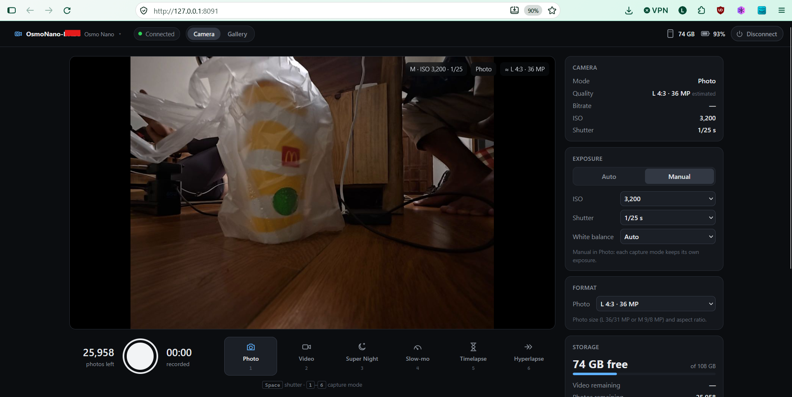
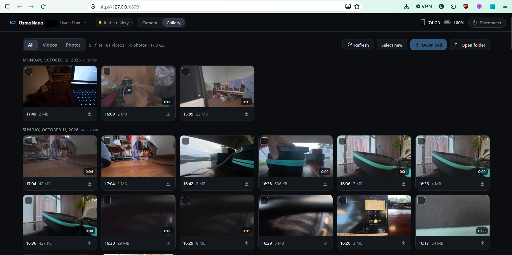
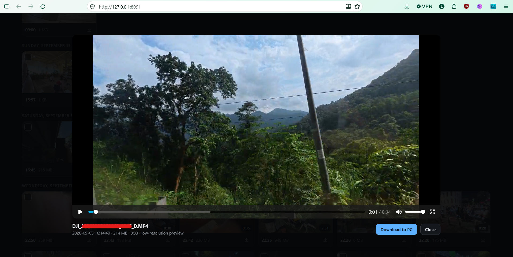
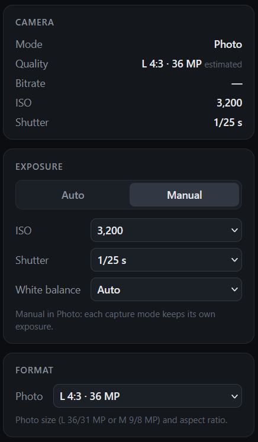
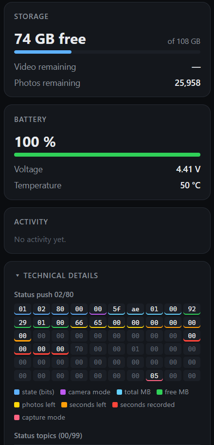
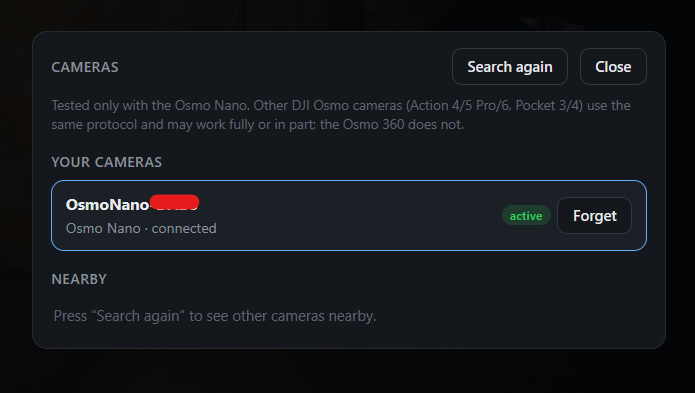

# Osmo Client

Control a **DJI Osmo Nano** from your computer over Wi-Fi: live view, capture modes, photo and video,
exposure and format settings, camera status, and a gallery to preview and download your files. Runs on
**Windows, macOS and Linux**.

> Unofficial and independent: not affiliated with, endorsed or sponsored by DJI. See [Legal](#legal).

The app runs locally and opens its page in your browser at <http://127.0.0.1:8091>.

> **New in 1.4 (experimental): Osmo Pocket 3, 4 and 4 Pro.** Live view (H.265 on the Pocket 4 and 4 Pro),
> gimbal and zoom controls. Built from another project's notes on these cameras, **not tested with a real
> Pocket yet**: reports are welcome.
>
> **Since 1.3: a field monitor.** Scopes, false color, zebras, focus peaking, frame guides and a display
> LUT over the live view; exposure compensation and the camera's light meter; color profile (D-Log M),
> field of view and stabilization; timelapse and hyperlapse settings; gallery favorites; a steadier live
> view. Experimental: the camera can join your Wi-Fi network instead of the computer joining the camera's.
>
> Since 1.1: macOS and Linux. macOS is tested end to end with the Osmo Nano; Linux is still being tested on
> real hardware. Reports are welcome.



## Features

- **Live view** of the camera, full screen if you like (double-click it). If the picture stalls, the app
  asks the camera for a fresh one and, if that is not enough, restarts the link, keeping the last picture
  on screen (marked NO VIDEO) meanwhile.
- **Monitoring tools** over the live view, as on a field monitor: histogram, waveform, RGB parade and
  vectorscope; false color, zebras (white or black-and-white stripes) and focus peaking; grids, frame
  guides (2.39:1, 1.85:1, 9:16…) and a center cross; a display LUT (`.cube`) applied only while the camera
  records in a log profile, or always; save a still of the picture as shown. Keys: `H` `W` `R` `V` `F` `Z`
  `P` `G` `L`. They work on the picture shown on the computer; nothing changes on the camera or in the
  recording. The LUT is for viewing only: the camera still records its log profile (D-Log M on the Osmo
  Nano) and you apply the LUT, or your own grade, when editing. Get the official LUTs from
  [DJI's LUT downloads](https://www.dji.com/lut).
- **Capture modes**: Photo, Video, Super Night, Slow-mo, Timelapse, Hyperlapse (keys `1`–`6`).
- **Shutter**: takes a photo, starts/stops recording or a timelapse, depending on the mode (`Space`).
- **Exposure**: Auto / Manual, ISO (Nano: up to 12800 in Video, 25600 in the other modes), shutter speed
  (1/8000 s–30 s), white balance (Auto or 2000–10000 K), exposure compensation (±3 EV in Auto), and the
  camera's own light meter. Each capture mode keeps its own exposure, as on the camera.
- **Image**: color profile (Normal, 10-bit, D-Log M), field of view, stabilization, sharpness and noise
  reduction, as the camera offers them in each capture mode.
- **Format**: video resolution (4K, 2.7K, 1080p in 16:9 or 4:3) and frame rate (24–60 fps), slow motion
  (120 fps 4×, 240 fps 8×), photo size and ratio (L 36/31 MP, M 9/8 MP), timelapse interval
  (0.5 s–1 h) and duration, hyperlapse speed.
- **Only what the camera offers**: the camera publishes what each capture mode supports (modes,
  resolutions and frame rates, ISO, shutter speeds, photo sizes), and the app offers exactly that. Until
  that arrives it uses the Osmo Nano's lists.
- **Status**: recording state and time, storage free and remaining (video time / photos; internal memory
  and microSD separately), estimated quality and bitrate, battery (%, voltage, temperature, charging), ISO and shutter in use (also in
  Auto).
- **Gallery**: browse the camera's files by day, filter videos/photos/favorites, preview (low-resolution
  video proxy or the photo, with resolution and frame rate), mark favorites (the camera keeps the mark),
  watch a 48–60 fps clip slowed down to 24/25/30 fps, and **download to the computer over Wi-Fi** (queue,
  progress, resumes if interrupted) into `DJI Osmo/<camera>` in your Videos folder (Movies on macOS). The
  list and thumbnails are kept on the computer, so the gallery opens at once, also with the camera off.
  **Delete** files on the camera (it always asks first; start the app with `--no-delete` to hide the
  option).
- **Several cameras**: link more than one; one is active at a time. Shows whether the camera is
  asleep or on while disconnected.
- **Shared Wi-Fi (experimental)**: instead of the computer joining the camera's Wi-Fi, the camera can join
  a network the computer is on (your router, or the computer's hotspot), so the computer keeps its
  internet without a second adapter. Set it per camera under Cameras → Wi-Fi → Change. Networks must allow
  WPA2 (the Osmo Nano refuses WPA3-only ones); guest networks that keep devices apart don't work. When you
  disconnect, the camera goes back to its own Wi-Fi.
- **Disconnect** button: releases the camera (so the phone app or the dock can use it) and puts your
  computer back on its own Wi-Fi without closing the app.

**Osmo Pocket 3, 4 and 4 Pro (experimental):** the live view (H.265 on the Pocket 4 and 4 Pro) and, only
while a Pocket is connected, a **Gimbal & zoom** card: hold the arrows (or the arrow keys; Shift: faster)
to pan and tilt, recenter (`C`), turn 180°, gimbal mode (Follow, Tilt locked, FPV, Direction lock) and
speed; zoom with the 1×/2×/4× buttons (1×/3×/6×/12× on the 4 Pro) or hold − / + (keys `-` `+`). Built
from the OpenPocketCine project's notes; not tested with this app yet.

Other DJI Osmo cameras (Action 4/5 Pro/6) use the same protocol and may work, fully or in part; the
commands were mapped on the Osmo Nano. The Osmo 360 is not supported.

Need the camera as a webcam for video calls? See the companion app,
**[OsmoCam](https://github.com/luisreysan/osmocam)**.

## Screenshots

**Gallery**: the camera's files by day, ready to download to the computer.



**Preview** of a video (low-resolution proxy) before downloading it.



**Settings and status**: exposure, format, storage, battery and the technical details panel.

<p>
  
  
</p>

**Cameras**: link one or more cameras and switch between them.



## Requirements

- A computer with **Bluetooth LE** and **Wi-Fi**:
  - **Windows** 10 or 11.
  - **macOS** 12 or newer.
  - **Linux** with **NetworkManager** (Ubuntu, Fedora, Mint, Debian desktop and most others) and BlueZ.
- **[Python](https://www.python.org/downloads/) 3.10 to 3.14** (3.14 recommended). Python 3.15 is too
  new for now: some of the libraries used here have no build for it yet. If you already installed 3.15,
  install 3.14 as well: with several versions installed, the app picks the newest from 3.10 to 3.14 by
  itself.
- **Internet through another adapter** (Ethernet, USB tethering or a second Wi-Fi adapter) if you need
  it while connected: the Wi-Fi adapter joins the camera's network. The first run also needs internet,
  to install the requirements.

## Install and run

Before you start: turn the camera on and close the DJI Mimo app on your phone (the camera accepts one
app at a time).

### Windows

1. Install **Python 3.14** from <https://www.python.org/downloads/windows/>.
2. Download the [latest release](https://github.com/luisreysan/osmo-client/releases/latest)
   (**Source code (zip)**) and extract it.
3. Double-click **`osmo-client.bat`**. The first run takes a minute: it creates a private Python
   environment and installs the requirements. Then the page opens in your browser.
4. Pick your camera under **Nearby** and click **Link**. The camera shows **"OSMO"**: approve it on the
   camera screen within ~20 seconds.

Stop with **Ctrl+C** in the console window: the PC's Wi-Fi goes back to the network it was on.

### macOS

1. Install **Python 3.14**: on <https://www.python.org/downloads/macos/>, download the **macOS 64-bit
   universal2 installer** of the latest Python 3.14 and run it. (The `python3` that comes with macOS is
   too old. With Homebrew: `brew install python@3.14`.)
2. Download the [latest release](https://github.com/luisreysan/osmo-client/releases/latest)
   (**Source code (zip)**). Safari unzips it in your Downloads folder.
3. Open **Terminal** (press Cmd+Space, type `Terminal`, press Return). Type `cd ` (with a space at the
   end), drag the unzipped folder onto the Terminal window, and press Return. Then run:
   ```
   sh osmo-client.sh
   ```
   The first run takes a minute: it creates a private Python environment and installs the
   requirements. Then the page opens in your browser.
4. macOS asks whether **Terminal** may use **Bluetooth**: click **Allow**.
5. Pick your camera under **Nearby** and click **Link**. The camera shows **"OSMO"**: approve it on the
   camera screen within ~20 seconds.

While connected, the Mac's Wi-Fi is on the camera's network, so there is no internet over Wi-Fi. When
you are done, click **Disconnect** on the page or press **Ctrl+C** in Terminal: the app makes the Mac
forget the camera's network and switches Wi-Fi off and on, and the Mac rejoins its usual network by
itself within a few seconds.

Next time, open Terminal, `cd` to the folder again (or press the Up arrow to find the earlier commands)
and run `sh osmo-client.sh`: nothing is installed again. Downloads go to `Movies/DJI Osmo/<camera>`.

### Linux

1. Install Python 3.10 to 3.14 if your system doesn't have it. On Debian and Ubuntu, also run
   `sudo apt install python3-venv`.
2. Download the [latest release](https://github.com/luisreysan/osmo-client/releases/latest)
   (**Source code (tar.gz)** or **(zip)**) and extract it.
3. In a terminal in that folder, run `sh osmo-client.sh` (or `./osmo-client.sh`). The first run takes a
   minute: it creates a private Python environment and installs the requirements. Then the page opens
   in your browser.
4. Pick your camera under **Nearby** and click **Link**, and approve **"OSMO"** on the camera screen.

The camera's network is saved in NetworkManager as a connection named after the camera, set to never
connect by itself or take over your internet route. Stop with **Ctrl+C**: the Wi-Fi goes back to the
connection it was on.

### Next time and updates

The app connects to the camera used last by itself. To update, download the new release and start it
the same way: your linked cameras are kept, and the private Python environment is reused (it is
updated only when the requirements change).

### Options

The same on every system (`osmo-client.bat` on Windows, `sh osmo-client.sh` on macOS and Linux):

```
--off                     start disconnected (connect from the page)
--downloads FOLDER        download folder (default: DJI Osmo in Videos, Movies on macOS)
--interface NAME          Wi-Fi adapter to use: "Wi-Fi 2" on Windows, en0 on macOS, wlan0 on Linux
                          (default: the first one)
--home NETWORK            Wi-Fi network to go back to on Windows and Linux (default: the one the computer is on)
--port 8091               port of the local page
--no-browser              don't open the page automatically
--no-delete               don't offer to delete files on the camera
--help                    everything else
```

## Good to know

- While the **Gallery** is open, the camera pauses its live view (like the phone app's album): it then
  sends files about 6× faster (~45 MB/s instead of ~8 MB/s) and stays cooler.
- Changing the format restarts the camera's encoder: the live view stops for a few seconds. Many changes
  in a row heat the camera; around 67 °C it stops charging and may drop Wi-Fi until it cools down.
- ISO and shutter can only be set in **Manual** exposure.
- There is no known command to put the Nano to sleep: after **Disconnect** it goes to sleep by itself
  after a while. **Connect** wakes it up.

## How it works

1. **Bluetooth LE**: finds the camera, pairs (the "OSMO" prompt), wakes it and asks for the name and
   password of its Wi-Fi access point.
2. **Wi-Fi**: the computer joins that access point (the camera is `192.168.2.1`).
3. **Datalink**: a small UDP protocol carries commands, status and the H.264 live view. Files download
   over HTTP from the camera.

The protocol is documented in [docs/PROTOCOL.md](docs/PROTOCOL.md).

Code layout:

| path | what |
|---|---|
| `osmo_client.py` | entry point: connection loop (Bluetooth → Wi-Fi → datalink) |
| `client/app.py` | commands, settings, gallery and camera selection |
| `client/state.py` | camera status parsed for the page |
| `client/downloads.py` | download queue |
| `client/server.py` | local web server and JSON API (127.0.0.1 only) |
| `client/web/index.html` | the page |
| `camlink/` | reusable protocol package: BLE, Wi-Fi (one backend per system), datalink, commands, media |

## Troubleshooting

- **The camera is not listed**: turn it on, bring it closer, make sure the phone app is not connected to
  it, then **Search again**.
- **Stuck at "Approve OSMO"**: look at the camera screen and accept the prompt (it lasts ~20 s); then
  click **Link** again.
- **No internet while connected**: expected on the Wi-Fi adapter; use Ethernet or a second adapter, or
  click **Disconnect** when you are done.
- **"Not available" for the microSD**: the dock's microSD is only listed when the camera is docked with
  a card inside.
- **"Python 3.10 to 3.14 is needed"** (or, with version 1.1.0 and older, **"Failed building wheel for
  winrt-…"** and **"Microsoft Visual C++ 14.0 or greater is required"**): only Python 3.15 is installed,
  and some libraries have no build for it yet. Install Python 3.14 as well (see
  [Requirements](#requirements)) and start the app again: it picks 3.14 by itself.
- **Windows, "Connection request failed with error 0x80342002"** (version 1.1.1 and older): Wi-Fi is
  turned off on the computer (the Wi-Fi button in the quick settings, or airplane mode). Newer versions
  turn it on by themselves; otherwise turn it on and try again. Bluetooth alone is not enough: the
  video and the files come over Wi-Fi.
- **macOS, "Bluetooth is not available" or no camera found**: allow Bluetooth for Terminal (or the app
  you started it from) in System Settings > Privacy & Security > Bluetooth, then start it again.
- **macOS 15 or newer, "No route to host"**: allow Terminal under System Settings > Privacy & Security >
  Local Network.
- **Linux, "NetworkManager (nmcli) was not found"**: join the camera's Wi-Fi yourself; its name and
  password are in `cameras.json` (see [Privacy](#privacy)). The app carries on once you are connected.
- **Linux, "Insufficient privileges"** when joining the camera: your user may not change network
  settings; ask your administrator, or join the camera's network yourself.

## Privacy

Everything stays on your computer. The app talks only to the camera and serves its page on
`127.0.0.1` (not reachable from the network). The cameras you link (Bluetooth address, name, and the
camera's Wi-Fi password), and the name and password of a shared network you choose for them, are stored in
`cameras.json`, shared with OsmoCam:

- Windows: `%LOCALAPPDATA%\osmo-pc\cameras.json`
- macOS: `~/Library/Application Support/osmo-pc/cameras.json`
- Linux: `~/.local/share/osmo-pc/cameras.json`

The same folder holds the app's private Python environment and, under `media`, each camera's last file
list and thumbnails (so the gallery opens at once). Downloads go to the folder you choose. No
telemetry.

## Legal

Osmo Client is an independent project, not affiliated with, endorsed or sponsored by DJI.
DJI, Osmo, Osmo Nano and DJI Mimo are trademarks of SZ DJI Technology Co., Ltd., used here only to name
the cameras this software works with. The repository contains no DJI code, firmware or assets. Its
purpose is interoperability: letting owners use their own camera with their computer.

It is provided "as is", without warranty of any kind (see [LICENSE](LICENSE)). It may stop working after
a camera firmware update. Use it at your own risk.

Third-party notices and credits: [NOTICE.md](NOTICE.md).

## License

[MIT](LICENSE)
